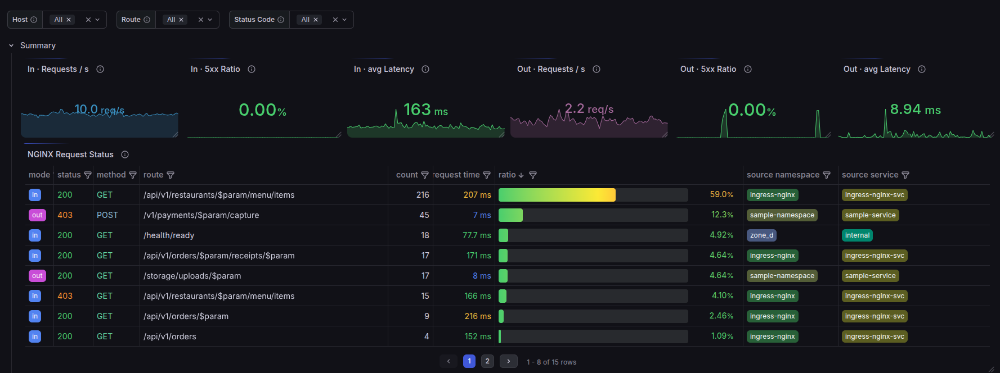
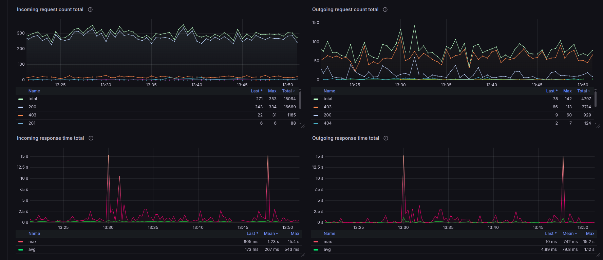

# Grafana dashboard

[`openresty-prometheus-exporter.json`](openresty-prometheus-exporter.json) is a
ready-made dashboard for everything this project exports: inbound, outbound
(including intercepted HTTPS), connections and L4 streams.

## Requirements

- **Grafana 12 or newer, with the v2 dashboard schema** (dynamic dashboards: tabs
  and tab-scoped variables). Built on Grafana 13.2.
- A **Prometheus** data source that scrapes both endpoints: `:9145/metrics`
  (HTTP) and `:9254/metrics` (stream).
- A **`namespace`** label on the scraped series. The Prometheus Operator
  ServiceMonitor in [`examples/openresty-sidecar/`](../examples/openresty-sidecar/)
  adds it (along with `pod`). Outside Kubernetes, add a `namespace` label in
  your scrape config.

## Import

Dashboards → **New** → **Import**, upload the JSON, then pick your Prometheus
in the **Data source** dropdown and a **Namespace**.

## Layout

Two dashboard-wide filters: **Data source** and **Namespace**. Every other
filter lives on the tab that uses it.

| Tab | Shows | Tab filters |
|---|---|---|
| Summary | In/out req/s, 5xx ratio and p95; a request status table; request count, response time and status-class ratio over time | host, route, status |
| Request breakdown | Request rate by status, method and host/route; per pod; inbound by caller (`source_namespace : source_service`); outbound by destination host | host, route, status |
| Latency percentiles | p99 / p95 / p50 per status, method and host/route | host, route, status |
| Last observed latency | Average and max of the last-seen request time | host, route, status |
| HTTPS interception | Share of outbound traffic that is visible (plain HTTP + intercepted HTTPS) vs opaque `CONNECT` tunnels; a ranked table of tunnelled `host:port`s to intercept next | — |
| Payload sizes | Average and max of request and response sizes; p50 / p95 / p99 from the size histograms¹ | host, route, status |
| Connections | Active / reading / writing / waiting, slot usage vs limit, keepalive reuse, connection age (incl. histograms¹), open stream tunnels | — |
| L4 streams | Session status table, sessions per destination, session duration and connect time (avg, max, p99, p95, p50), throughput both legs, time to first byte, open sessions per destination | status (L4 codes) |
| Exporter health | `nginx_metric_errors_total`, pods reporting, series per pod, distinct routes / hosts / callers over time: catches a sanitizer gap before it hurts your Prometheus | — |

¹ The request/response size and connection histograms are off by default; those
panels show *No data* until you turn them on, e.g.
`METRICS_CONFIG="http.metric_request_size_histogram=true;http.metric_response_size_histogram=true"`.
See the [metrics reference](../docs/metrics-reference.md).

`/metrics` and empty routes are excluded from the route-based panels.

For what each metric and label means, see the
[metrics reference](../docs/metrics-reference.md).
